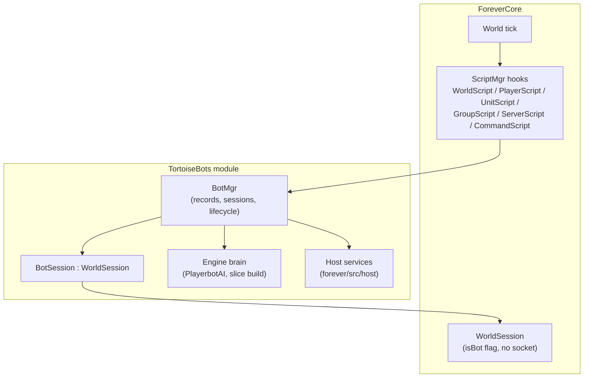

# Architecture Invariants & Core Boundaries

TortoiseBots is an optional module for ForeverCore (a TrinityCore-based core). The core builds and runs without it; everything bot-specific lives in the module.

## Architectural Boundaries

For ForeverCore, the module is built by this repository's root CMake (`BUILD_TORTOISEBOTS=1`); the Turtle core ignores that file and collects `src/` through `TortoiseBots.cmake` instead. The legacy bot engine is a separate option, `TORTOISEBOTS_SLICE1`, which adds the `ai/playerbot` files listed in `forever/SLICE-W4.txt`.

## The four invariants

| Invariant | Rule | How the build enforces it |
| :--- | :--- | :--- |
| **1. Optional module** | The core compiles and runs with `BUILD_TORTOISEBOTS=0`. Bot AI, commands and host services never enter core source. | CMake returns early when the option is off; module sources live under `forever/src`. |
| **2. No bot AI in the core** | The core owns sessions, maps, spells and packets; the module owns bot records, decisions and strategies. The core's bot-specific surface is the session `isBot` flag and the generic accommodations that read it. | Module-only sources; the core is unmodified apart from the public script and session API. |
| **3. Module-owned bot sessions** | A bot is a `TortoiseBots::BotSession`, a `WorldSession` subclass constructed with the core's `isBot` flag. It logs in through the normal character load, has no socket, and drops everything the server sends except the cast-result packets the engine reads. | `BotSession` uses only public `WorldSession` members; the core writes `online` state per character for bot sessions. |
| **4. One world thread** | Bot records, AI objects, strategy graphs and host services are touched on the world thread only. Hooks that can run elsewhere queue a copy and the world tick drains it. | `BotMgr::Update` runs from `WorldScript::OnBeforeMapsUpdate`; the addon channel has its own queue. |

The build also refuses to configure with the core's own PlayerbotV2 module enabled: two bot systems would register two `.bot` command sets and two session drivers.

## 1. Optional module

`CMakeLists.txt` is for ForeverCore only. It declares `BUILD_TORTOISEBOTS` (default off) and returns immediately when it is off. The module target is a static library built from `forever/src`; the slice build adds the legacy engine files from `forever/SLICE-W4.txt`, the replaced factory/context sources, and the shared trace, decision-capture and combat-monitor runtime units.

The Turtle build path still exists in the repository (`TortoiseBots.cmake`, `src/`, `host/`, `runtime/`), but it is not what this documentation describes: those host adapters are not compiled into the Forever module.

## 2. No bot AI in the core

The core knows a session can have no socket and that a player can be driven by a module; it does not know what a bot decides. There is no `WorldSession::GetBot()`, no `Player::m_bot`, no `sPlayerBotMgr` and no `PlayerBotEntry` anywhere in the core source.

The `isBot` flag is read by generic mechanics that must treat a socketless actor correctly, not by bot AI: session teardown and `online` bookkeeping, the group rolecheck/repop participants, battleground queue accounting, achievements, pet handling, death recap, and auto-equipping of new bags. Anything the engine needs from the world arrives through script hooks, public `Player`/`Unit` APIs, or the module's own compat layer.

## 3. Module-owned bot sessions

`BotSession` is a normal `WorldSession` created with the core's `isBot` flag. It:

- starts the ordinary character load (`LoginQueryHolder`) and enters the world through `HandlePlayerLogin`;
- sends nothing and keeps nothing the server sends, except `SMSG_SPELL_FAILURE`, `SMSG_CAST_FAILED` and `SMSG_SPELL_DELAYED` for the bot's own cast, copied into a bounded queue for the engine;
- has no socket, so the core skips socket teardown and the account-level `online` write, and clears only that character's online flag;
- is owned by the module's `BotMgr`, not by the core's session map.

`BotMgr::Login` refuses a second session on the same game account (owned bots of one Battle.net account may share a game account under the stated conditions). A bot is also logged out when the account's real session begins loading, so an owner reclaiming the character keeps it.

## 4. One world thread

The host tick is `WorldScript::OnBeforeMapsUpdate`: it calls `BotMgr::Update` and then the pool, battleground, dashboard and (in the slice build) run/feed/trace services. Bots with a master and owned bots are visited first and whole; the rest form a turn queue that the per-tick budget may cut. Bot sessions that are still loading, teleporting or logging out are never cut.

Player-facing entry points:

| Entry | Thread and handling |
| :--- | :--- |
| `.bot` command | `PlayerScript::OnCommand`, inline on the world thread (chat opcodes are thread-unsafe and run there). It refuses without the engine or with the module off, and the core then answers the word normally. |
| TBM addon message | `PlayerScript::OnAddonMessageSent` copies the requester key and text into a bounded queue (never a `Player` or session pointer); a separate world `OnUpdate` script drains it. Bots cannot drive the channel. |
| Bot chat (whispers/party) | `PlayerScript::OnChat` (`host/chat/TbChatIn.cpp`) hands a copy to the bot's inbox; the world tick drains the arrivals before the bot pass and the engine reads them on its next turn. |
| `.tb` console/GM command | `CommandScript` table in `forever/src/TbScripts.cpp`; each handler validates the caller and reads live state through the public API. |
| Cast result | `BotSession::SendPacket` may be called from any sending thread; it only touches the cast-result queue's mutex and counters. The engine drains it on the world thread. |

## Lifecycle and shutdown

`BotMgr` owns every bot record and session. Logout paths drop the engine brain before the `Player` is deleted, because the legacy engine holds a `Player` pointer. At server shutdown the module saves and logs out every bot while the world is still up. A bot whose master logs out waits for the configured grace period, then logs out; an owned bot leaves with its owner instead of waiting.

## Policy headers by domain

Pure decision rules live in `*Policy.h` headers grouped by domain: `ai/playerbot/policy/<domain>/` for bot-AI rules (ah, bg, class, combat, death, dungeon, gear, group, guild, heal, item, loot, profession, pull, quest, raid, rpg, town, travel, world) and `runtime/policy/<domain>/` for lifecycle/service rules (ah, class, guild, hire, infra, lfg, movement, pet, provision, pvp). Includes use paths relative to the existing include roots (for example `playerbot/policy/travel/TravelRoutePolicy.h`), so no new include directory is needed.

## Onyxia observer

The opt-in Onyxia observer is a module host service (`forever/src/host/TbOnyxia`), not a core boss-script change. It exists only in the slice build and only while a GM starts it with `.tb onyxia`; observations and watches are cleared independently for each bot and instance. Its core-free phase policy is covered by `tools/test_forever_onyxia.cpp`.

## Related boundaries

Player-facing boundaries, gameplay quirks and project non-goals are catalogued in [Known Limitations & Quirks](../play/known-limitations.md).
