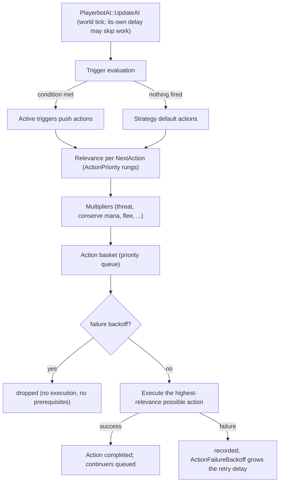

# Strategy Engine & Action Scheduling

TortoiseBots runs PlayerbotAI, an action-scheduling engine derived from Playerbots. Bot behavior emerges from composable **strategies**, **triggers**, **actions** and **multipliers** rather than a monolithic behavior tree.

The engine exists only in the `TORTOISEBOTS_SLICE1` build, which compiles the `ai/playerbot` files listed in `forever/SLICE-W4.txt`. The `.tb` test commands can start a bot without an engine, but it then only follows, assists and stands: no decisions, no chat commands, no strategies.

## Registrations are the contract

The engine skips a key that is not registered. On the Forever build the registry is the generated `forever/src/slice/SliceAiObjectContext.cpp`: only the keys listed in `forever/tools/slice_gen_context.py` exist, even when `ai/playerbot` contains the class. Class contexts (warrior, priest, mage, rogue, druid, paladin, shaman, hunter, warlock) add their own keys on top of that constructor.

The generator's comments state which keys each slice leaves out and why. When a behavior seems missing, check the key list before reading the action class.

## The execution cycle

A *minimal* tick processes triggers normally but defers queue entries whose relevance is below 100 instead of executing them; the basket stays intact for the next full turn.

## Module pass and world-tick scheduling

The module drives every bot from one pass on the world thread: `BotMgr::Update`, called from `WorldScript::OnBeforeMapsUpdate` at the start of a world tick. The pass has two ordered phases:

1. **Bots with a master first.** A bot with a master (a real player or a bot leader), or an owned alt of a player, is visited whole on every pass and is never cut by the budget: a player waits on its reactions.
2. **The pool second, as one rotation.** Pool bots with no player waiting are visited in the order the previous pass left them; the bot the budget cut becomes first next pass, so no bot waits two rounds.

The budget engages only while the previous world tick ran longer than `AiPlayerbot.PoolBudgetWhenTickOverMs` (default 0 = every tick). `AiPlayerbot.PoolTickBudgetUs` and `AiPlayerbot.CombatTickBudgetUs` are its ceilings, and the `AiPlayerbot.TargetWorldTickMs` controller reclaims the full ceilings on healthy ticks. The engine config is read through `engine::ReadTickBudgetConfig`, so the operator keeps TB's key names.

Each visited bot gets the time since *its own* last turn, not one world tick, so a skipped bot does not stretch its think cadence, retries or cast delays. The host tracker (500 ms) runs the module's own bookkeeping (death/ghost checks, entry jobs, master-away grace); the engine then runs `PlayerbotAI::UpdateAI` with that elapsed time.

Every ~30 s of tick time the pass writes one `BOTPERF` line to the module log with the fleet counts and budget figures. `.tb perf` prints the same budget figures.

## Core building blocks

| Component | Responsibility | Registered examples |
| :--- | :--- | :--- |
| **Strategy** | High-level posture or intent container; registers triggers, actions and defaults | `close` (melee combat), `ranged`, `threat`, `dead`, `grind`, `chat`, `flee`, `conserve mana` |
| **Trigger** | Boolean context check, re-evaluated every turn | `critical health`, `low mana`, `medium health`, `target critical health`, `combat start`, `enemy out of melee` |
| **Action** | Concrete world interaction or spell cast; returns success | `reach party member to heal`, `reach spell`, `food`/`drink`, `healing potion`, `interrupt current spell` |
| **Multiplier** | Scales an action's relevance (including to zero) | `ThreatMultiplier`, `ConserveManaMultiplier`, `FleeMultiplier` |
| **Backoff** | Anti-looping failure throttling | `ActionFailureBackoff` in `strategy/ActionFailureBackoff.h`, owned by `Engine.h` |

The failure backoff keys one entry by action, source, target, destination and result. Repeated failures double the delay (base, 2x, 4x, 8x, 16x, capped at a maximum). Success clears the entry; map changes and explicit commands clear it through the engine. Its time and cap come from the engine's own configuration.

## Action relevance tiers

Relevance is an unbounded float per `NextAction`; conventional rungs come from the `ActionPriority` enum:

`ACTION_IDLE` (1), `ACTION_DEFAULT` (5), `ACTION_NORMAL` (10), `ACTION_HIGH` (20), `ACTION_MOVE` (30), `ACTION_INTERRUPT` (40), `ACTION_DISPEL` (50), `ACTION_LIGHT_HEAL` (60), `ACTION_MEDIUM_HEAL` (70), `ACTION_CRITICAL_HEAL` (80), `ACTION_EMERGENCY` (90), `ACTION_PASSTROUGH` (100).

Typical occupants: rotational DPS around `NORMAL`/`HIGH` (10–20), movement at `MOVE` (30), interrupts at `INTERRUPT` (40), heals climbing `LIGHT`/`MEDIUM`/`CRITICAL` (60/70/80), emergencies at `EMERGENCY` (90), passthrough overrides at 100. Strategies add small offsets (for example `ACTION_NORMAL + 3`) to order within a rung.

## Where the engine meets the host

The host hands the engine a bot's session packets, chat lines, teleports, knockbacks and the elapsed time; see [host-api.md](host-api.md) for the seam and its thread rules. Campaign behaviour (pool, errands, guild orders, mail, auction house, LFG fill) lives in the module's host services and does not enter the engine's strategy graph.
