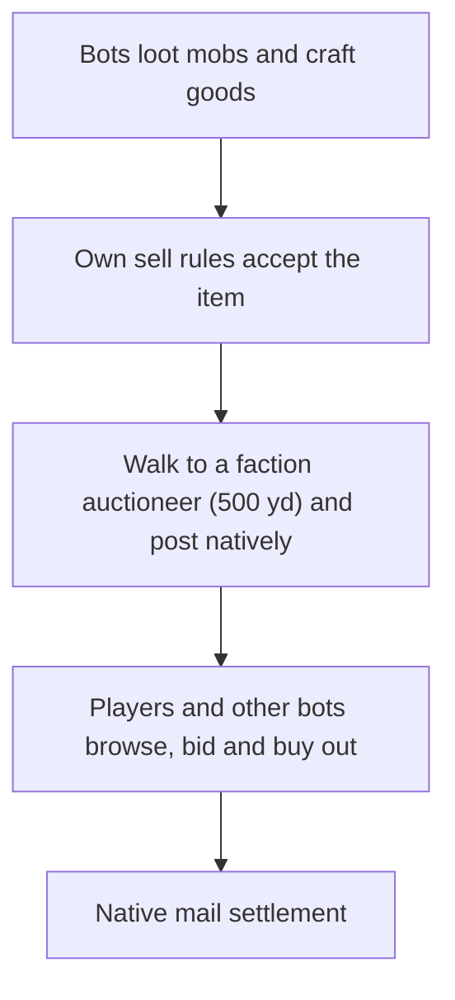

# Economy & auction house

This page explains how bots generate gold, repair their equipment, sell surplus items to vendors, and take part in the auction house. The settings live in `aiplayerbot.conf` and `tortoisebots.conf`; see [Economy & auction house settings](../server/settings/economy.md).

## Economic philosophy

The Forever build gives bots no extra starting money and no seed gear: the pool creates plain level-1 characters with only the core's own starting items, and everything after that is earned.

- **Looted and crafted goods:** items listed on the Auction House come from creature drops, quest rewards, gathering and bot crafting.
- **Earned gold:** bots earn coin from quests, kills and vendor sales. Nothing is granted on login.
- **Equipment:** a bot wears what it loots, crafts, buys or is given; the optional [`AiPlayerbot.PoolGearTopUpOnLevel`](../server/settings/economy.md#aiplayerbotpoolgeartopuponlevel) only fills empty or badly outdated slots at level-up. The autogear command can dress a bot on demand.
- **Food and tools:** [`TortoiseBots.AutoFood`](../server/configuration.md#forevercore-module-keys-tortoisebotsconf) keeps free and pool bots supplied with level-fitting food and water, and [`TortoiseBots.AutoTools`](../server/configuration.md#forevercore-module-keys-tortoisebotsconf) supplies the tool of each profession they know. Ammunition, reagents and crafting materials are bought, looted or crafted like any other item.

## Vendor liquidation & repairs

Bots manage their own money by balancing earnings against repairs, training and travel:

| Activity | Behavior | Control |
| :--- | :--- | :--- |
| **Vendor sales** | Bots sell grey junk and surplus gear in batches to avoid needless travel. | [`AiPlayerbot.VendorBatchMinCount`](../server/settings/economy.md#aiplayerbotvendorbatchmincount--vendorbatchminbagspace) |
| **Low-level vendor trips** | Bots below level 5 sell early items to nearby camp vendors. | [`AiPlayerbot.LowLevelVendorMaxDistance`](../server/settings/economy.md#aiplayerbotlowlevelvendormaxdistance) |
| **Spell money** | A bot short on gold for a trainable spell rank liquidates bags to fund training. | Automatic AI logic |
| **Equipment repairs** | Bots visit a repair vendor when overall durability drops below 30%, or any item below 10%. | Automatic AI logic |
| **Inventory cleanup** | When bags fill and no vendor is reachable, bots destroy low-value items in a fixed order. | Automatic AI logic |

Vendor trip batching & low-level sales in detail

- **Standard batching (level 5+):** a bot starts a vendor trip when its vendor-usable stock reaches [`AiPlayerbot.VendorBatchMinCount`](../server/settings/economy.md#aiplayerbotvendorbatchmincount--vendorbatchminbagspace) items and its bags are at least `VendorBatchMinBagSpace` percent full. A bot short on gold for its next trainable spell rank also heads to a vendor when its stock would cover the price, and bags at 80% or more also make it sell.
- **Beginner batching (levels 1-4):** the lower pair [`AiPlayerbot.LowLevelVendorBatchMinCount` / `LowLevelVendorBatchMinBagSpace`](../server/settings/economy.md#aiplayerbotlowlevelvendorbatchmincount--lowlevelvendorbatchminbagspace) lets new characters sell early pelts and broken weapons without waiting for full bags.
- **Camp distance:** masterless bots below level 5 only use vendors within [`AiPlayerbot.LowLevelVendorMaxDistance`](../server/settings/economy.md#aiplayerbotlowlevelvendormaxdistance).
- **Flip buys:** bots buy limited-supply stock to relist on the Auction House. Recipes and gear are bought once per item per visit; stackable stock is bought up to 10. Hunters and gun users buy ammo when they do not carry any.

Protected inventory items & cleanup order in detail

- **Protected goods:** the usage classifier, not a sell filter, keeps rations the bot eats, bandages, potions, spell reagents and ammunition matching the equipped weapon out of vendor trash. Usable food, drink, potions and bandages are kept at any level.
- **Liquidated stock:** only grey trash, unneeded profession materials, and surplus equipment scoring lower than equipped gear are sold.
- **Destruction order:** when bags reach 90% and no vendor can be reached, bots destroy useless items first, then quest-class items only when coin is needed for a spell rank, then the cheapest grey trash, then materials and consumables last.

Mount savings & trainer reserves in detail

- **Trainer reserve:** bots keep back the money for upcoming class ranks. A trainer visit charges only ranks the bot can learn at its level.
- **Mount travel:** [`AiPlayerbot.MountBreakEvenFactor`](../server/settings/economy.md#aiplayerbotmountbreakevenfactor) keeps bots on foot for short trips: roughly 50 yards on a 60% mount and 30 yards on a 100% mount with the default `1.5` (`0` mounts for any trip).

## Living Auction House

Free bots sell their own loot on the Auction House and buy upgrades there with their own gold, so the house fills the way it would on a busy server. Both sides need [`TortoiseBots.World.Auction = 1`](../server/configuration.md#forevercore-module-keys-tortoisebotsconf) and online bots ([Managing & Resetting the Bot Pool](../server/bot-pool.md)).

- **Bot sellers:** [`AiPlayerbot.AhMarketEnabled`](../server/settings/economy.md#aiplayerbotahmarketenabled) runs the seller pass every [`AiPlayerbot.AhMarketInterval`](../server/settings/economy.md#aiplayerbotahmarketinterval) seconds. A free bot with sellable stock that is out of combat, ungrouped and on an open-world map walks to a faction auctioneer within 500 yards and posts what its own rules accept. A bot already at an auctioneer posts at once. Nobody is teleported.
- **Bot buyers:** [`AiPlayerbot.AhMarketBuyer`](../server/settings/economy.md#aiplayerbotahmarketbuyer) lets a free bot that is already standing at a faction auctioneer scan the house (on a [`AiPlayerbot.AhMarketChanceBuy`](../server/settings/economy.md#aiplayerbotahmarketchancebuy) roll) and buy an affordable weapon or armour upgrade with its own gold. The buyer never walks, never teleports and skips its own listings.
- **Native mail settlement:** all bot auction transactions use the core's auction and mail systems. Gold owed to a player arrives in that player's mailbox.
- **No offline stocking:** the offline AHBot stock and buyer service is **Not on ForeverCore yet.** The house is filled by the bots that are online.

Organic buyer mechanics in detail

- Only a free, idle, ungrouped, alive bot on an open-world map, already within interact range of a faction auctioneer, can buy. There is no walk to the house and no per-bot trip clock.
- Each pass rolls `AiPlayerbot.AhMarketChanceBuy` percent. On a pass, one page of the house is scanned, rotating through pages.
- Candidates are weapons and armour the bot can equip, uncommon quality or better, that its own item-usage value calls an upgrade; its own and its account's listings are skipped.
- The price ceiling is three times the item's unit value (four times the vendor buy price, ten times the sell price when no unit value is known), and [`AiPlayerbot.AhMarketMaxSpendPerBot`](../server/settings/economy.md#aiplayerbotahmarketmaxspendperbot) can cap a single purchase.
- The scan stops at [`AiPlayerbot.AhMarketMaxOperations`](../server/settings/economy.md#aiplayerbotahmarketmaxoperations) probes, at [`AiPlayerbot.AhMarketBudgetUs`](../server/settings/economy.md#aiplayerbotahmarketbudgetus) microseconds, or after eight items on the page.

## Market administration

- **Watch it:** the server log prints one `[W8] ah-market` line per seller pass and one `[W8] ah-market-buy` line per buyer scan, with the bot and result.
- **Keep the house honest:** [`AiPlayerbot.AhSellBlacklist`](../server/settings/economy.md#aiplayerbotahsellblacklist) names item ids bots never list; items any vendor sells without a stock limit are skipped automatically.
- **Drop-rate tuning is not available here:** the green and blue loot boost (`AiPlayerbot.BotLootRateUncommon` / `BotLootRateRare`) is **Not on ForeverCore yet.**
