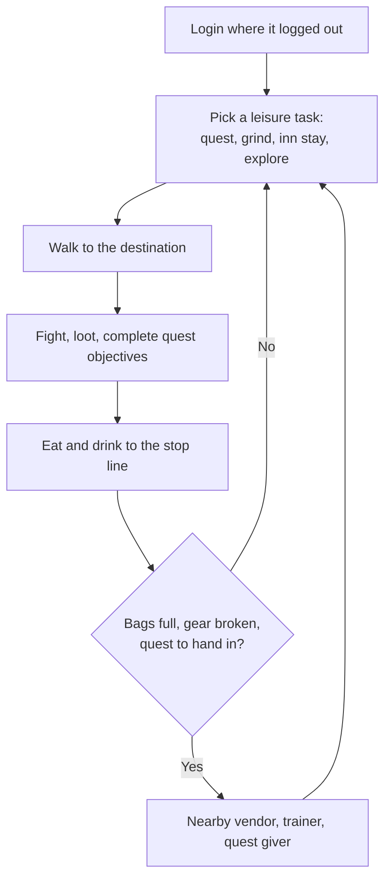

# Living world & autonomous bots

This page explains how free pool bots live in the world: how they travel, grind, quest, gather, rest and gear up. The pool itself (characters, accounts, sessions) is described in [The bot pool](../server/bot-pool.md); its settings and the immersion settings are in [World population & immersion settings](../server/settings/world-population.md).

## Before anything moves

Three switches decide whether a bot lives on its own:

1. `TortoiseBots.Enable = 1` — the module runs at all (it is `0` in the template).
2. `TortoiseBots.Pool.Enable = 1` and `.tb pool start` — the pool creates characters and keeps them in the world. The schedule never starts by itself, and the online target is `0` until it is set (`.tb pool population low|high|<n>`).
3. The real bot engine on the bot: `TortoiseBots.Slice.EngineByDefault = 1`, or `.tb engine <bot> on` for one bot. Without it a logged-in bot only follows and assists.

A bot is "free" when it has no master and no group: that is the pool bot this page is about. Your alts follow you instead.

## The free bot's day

A free bot runs a small kit: grind, travel, food, loot, roll, its class kit, buffs and emotes. Questing, town errands and exploration are added on top unless [`AiPlayerbot.AutoDoQuests`](../server/settings/world-population.md#aiplayerbotautodoquests) is turned off.

A pool bot's session ends after 30 to 90 minutes (rolled), it stays away for 5 to 20 minutes and comes back. A bot that gets a master leaves the pool's online count and is not logged out by the pool.

## Open-world activities

| Activity | How it works |
| :--- | :--- |
| **Zone travel** | Free bots walk (and swim) to their destination. A destination area may be at most five levels above the bot; a trip whose walk crosses a hostile-faction town or a far-higher area is refused before it starts. |
| **Grinding** | Bots pick level-appropriate creatures within sight distance and fight them with their class rotation. |
| **Grind-spot ladder** | A grind destination's creatures sit between two levels below and one level above the bot (two above from level 10), so a bot moves on as it outgrows an area. |
| **Questing** | Bots accept level-appropriate quests, do the objectives and turn them in. See the rules below. |
| **Leisure mixer** | A free bot picks its next journey from a weighted roll: questing 60, grinding 15, a stay at an inn hub 10 (level 5 and up), exploration 5. It re-rolls at once when the winner stops being possible. |
| **Town services** | Within 50 yards a bot uses the quest giver, trainer or vendor next to it; from 85% bag fill it sells at the next vendor whatever the batching says. |
| **Gathering** | Off by default (`TortoiseBots.World.Professions`). When on, free bots gather herb and ore nodes within 150 yards in their zone. |
| **Fishing** | On by default (`TortoiseBots.World.Fishing`): a free bot with a pole now and then fishes a hole or open water near where it already stands — one session an hour, at most five casts in five minutes, never in a dungeon or raid and never in combat. |
| **Capital errands** | On by default (`TortoiseBots.World.CapitalErrands`): in a capital a bot runs mailbox, trainer and bank errands, duels other bots at the gates, and learns riding and buys its mount from its own gold at 40 and 60. Auction-house errands need `TortoiseBots.World.Auction`. |
| **Quest parties** | Free bots with the same group quest form a party nearby; see [Grouping](social.md#grouping). |
| **Pickpocket & lockboxes** | Rogues pick pockets and open lockboxes they carry; a lockbox the bot cannot open is mailed to a rogue in its own guild. On by default (`TortoiseBots.World.Pickpocket`, `TortoiseBots.World.Lockboxes`, `TortoiseBots.World.LockboxMail`). |
| **Profession upkeep** | Enchanters disenchant junk and enchant their own gear; both on by default (`TortoiseBots.World.Disenchant`, `TortoiseBots.World.EnchantGear`). At level 60 a bot's gear enchant follows the common Forever choice for its spec and slot, and slots players leave empty stay empty. |
| **Passing buffs** | A pool bot passing a real player buffs them and keeps walking; see [Passing buffs](social.md#passing-buffs). |

Travel & getting unstuck in detail

Bots choose a destination, then walk it. Three rescues cover the cases walking cannot:

- A bot that fails three times at the same spot within 20 minutes is rescued by its unstuck escape: a hearthstone back to its bind point, or a repop.
- A trip that makes no progress until the retry limit is given up on with a teleport instead: with [`AiPlayerbot.StuckTravelTeleport`](../server/settings/world-population.md#aiplayerbotstucktravelteleport) on (it is), a masterless bot with no real player within 150 yards of either end is placed next to its destination, at most once every ten minutes.
- A bot trapped off the walking graph (an island or a floor pocket) is moved to the nearest route node instead, under the same "nobody watching" rule.

Teleports are never routine movement. There is no taxi travel yet: the flight-path planner needs the taxi-node zone table, which this build does not fill, so bots walk.

Grinding rules in detail

- Targets are within sight distance ([`AiPlayerbot.SightDistance`](../server/settings/combat.md#aiplayerbotsightdistance)); melee bots close in, ranged bots hold spell distance.
- A free bot never starts a fight with a real player, anything a player controls, a service NPC (quest giver, vendor, trainer, flight master, innkeeper), a guard, a civilian, a kill that would lower a faction standing, or a creature another player has tapped. If something attacks the bot, it defends itself.
- A grey (no-experience) creature is never worth starting a fight over.
- A grind order caps at one level above the bot below level 10 and four above from level 10. Above the cap only a quest's own objective is allowed, and below level 10 even that is capped.
- Creatures the core reports as unreachable or evading are skipped.
- Rare creatures of the bot's level within sight distance are preferred when [`AiPlayerbot.HuntRares`](../server/settings/world-population.md#aiplayerbothuntrares) is on.

Questing & quest-log upkeep in detail

- A masterless pool bot below level 10 only takes a quest rated at most one level above its own; the giver offers it again when the bot catches up.
- A solo bot refuses the quests it could not finish alone: more than three levels above it, elite, dungeon or raid quests, and quests that suggest a group. A bot with a party strong enough to fight a boss keeps them.
- War-effort material turn-ins and a small banned list are refused at accept, so they cannot fill the log.
- With [`AiPlayerbot.BotQuestLogUpkeep`](../server/settings/world-population.md#aiplayerbotbotquestlogupkeep) on, the log is triaged: failed quests, quests more than three levels over, non-solo quests, group quests and quests belonging to another zone are dropped when slots run low; a finished quest is never dropped, it is turned in.
- Grey quests that can no longer progress are abandoned; a finished grey quest is still handed in.
- Quest rewards are picked by [`AiPlayerbot.AutoPickReward`](../server/settings/world-population.md#aiplayerbotautopickreward).

## Progression

Pool characters are created at level 1. On a fresh bot's first login the module rolls its start level between `AiPlayerbot.RandomBotStartLevelMin` and `AiPlayerbot.RandomBotStartLevelMax` (defaults `1` and `60`), and from then on it levels by playing. The level ladder (`AiPlayerbot.LevelLadder`, on) only decides which level bands are online at a time; it never changes a bot's level. See [the bot pool](../server/bot-pool.md#spawning-a-bot-start-level-and-gear).

| What bots get | Setting |
| :--- | :--- |
| **Class spells** on login and on every level-up, free | `TortoiseBots.AutoLearnOnLevel` (on) |
| **Talent points** spent on login and level-up following a premade build (never a reset); the builds are the level-60 picks of Forever players for each spec | `TortoiseBots.AutoTalentsOnLevel` (on) |
| **Class-quest spells** (stances, forms, totems, pets, racials) when a quest of the running world teaches them, class-masked or implied by the spell | `TortoiseBots.ClassQuestSpells` (off; the class-line autotrain already teaches these, so turning it on adds a family-0 row such as the paladin's *Sense Undead*) |
| **At level 5, a class-sensible pair of primary professions plus First Aid and Cooking** | `TortoiseBots.AutoProfessions` (on) |
| **Profession tools** (pick, knife, hammer, spanner, rod, pole) in a free bag slot | `TortoiseBots.AutoTools` (on) |
| **Food and water** fitting the bot's level, on login and level-up | `TortoiseBots.AutoFood` (on) |
| **A starter hunter pet** at level 10, with its pet spells | `TortoiseBots.AutoHunterPet` (on) |
| **Pet skills** on every level-up for pool bots and your own bots | [`AiPlayerbot.PetAutoTrain`](../server/settings/world-population.md#aiplayerbotpetautotrain) (on) |

## Gear

Bots keep what they find and equip what is better:

- **Loot upgrades:** with [`AiPlayerbot.AutoEquipUpgradeLoot`](../server/settings/world-population.md#aiplayerbotautoequipupgradeloot) on (it is), a bot equips a drop that beats the item in the slot. [`AiPlayerbot.EquipUpgradeThreshold`](../server/settings/world-population.md#aiplayerbotequipupgradethreshold) (1.1) is the margin an item must clear.
- **Pool gear top-up:** [`AiPlayerbot.PoolGearTopUpOnLevel`](../server/settings/world-population.md#aiplayerbotpoolgeartopuponlevel) is off; when on, a pool bot fills empty slots and replaces clearly outdated grey and white gear once per level, never green or better.
- **Autogear for your own bots:** `.bot autogear <bot>` re-gears one of your own bots; pool bots are refused and keep progressing on their own. The command is off until [`AiPlayerbot.OwnedBotAutogearEnabled`](../server/settings/world-population.md#aiplayerbotownedbotautogearnabled) is turned on, and it stays within the quality and item-level caps. The player-facing `.autogear` builds a level-appropriate outfit within [`AiPlayerbot.RandomGearMaxLevel`](../server/settings/world-population.md#aiplayerbotrandomgearmaxlevel) and [`AiPlayerbot.RandomGearMaxItemLevelAboveLevel`](../server/settings/world-population.md#aiplayerbotrandomgearmaxitemlevelabovelevel), skipping the item ids in [`AiPlayerbot.RandomGearBlacklist`](../server/settings/world-population.md#aiplayerbotrandomgearblacklist).
- **Spawn kit:** a fresh pool bot rolls its start level on its first login and, at level 5 or above, receives one level- and spec-fitting gear kit ([`TortoiseBots.Pool.GearOnCreate`](../server/configuration.md#forevercore-module-keys-tortoisebotsconf), on by default). The Turtle build's hand-made starting bags, ammo pouches and thrown-weapon seeding are still not part of this build; ammo, tools and food come from the module's own upkeep.

## Mounts

A bot does not receive a mount at a fixed level. A free bot learns riding and buys its own mount from a capital vendor once it reaches level 40 (and the faster one at 60) during a capital errand; the money comes from its own purse. The capital mount errand always buys from the bot's own race's vendor mounts; [`AiPlayerbot.RandomBotShopMounts`](../server/settings/world-population.md#aiplayerbotrandombotshopmounts) (off by default) affects only the AI's mount-list check.

## Sustenance & resting

Bots keep themselves going between fights:

- **Eating and drinking at once:** out of combat a resting bot eats and drinks in one sitting.
- **Stop lines:** a resting bot eats and drinks until 50% health and 85% mana, the lines the engine uses when it has no item cheat (pool bots on this build never get the cheat). A rest order tops it to 100%.
- **Interruption:** a resting bot stands up and fights when something attacks it; entering combat also ends a rest order.
- **Food supply:** pool bots receive level-fitting food and water on login and on level-up (`TortoiseBots.AutoFood`); your own alts buy theirs.
- **Mage conjuration:** a mage bot in a group conjures food and water and trades it to members who have none, when its own mana allows.

## Not on ForeverCore yet

- Flight paths and boat travel for free bots; they walk.
- The Turtle starting kit's bags, quivers, ammo pouches and thrown-weapon seeding. (A fresh pool bot does get the module's own one-time spawn kit, above.)
- Camping sessions with a tent; the "stay at an inn hub" leisure trip exists, the camp kit does not.
- Offline AHBot stocking and buying; online free bots use the auction house directly when `TortoiseBots.World.Auction = 1` (see [Bot economy](economy.md)).
